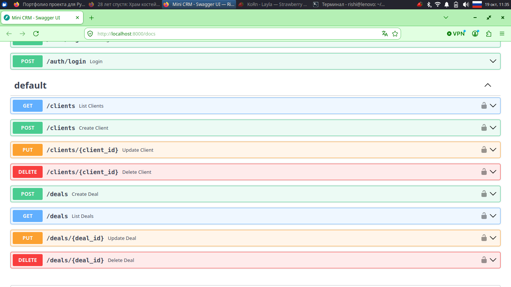

# Mini CRM API



A small REST API for managing clients and deals, built with FastAPI.
Includes JWT authentication, SQLite storage, automated tests and Docker support.


## Features

- CRUD for clients and deals
- Deal statuses: `new`, `in_progress`, `closed`, with filtering by status
- JWT authentication (register / login), all CRM endpoints are protected
- Validation: non-negative amounts, deals only for existing clients,
  clients with deals cannot be deleted
- Automated tests with pytest (isolated in-memory database)
- Runs in Docker with a persistent volume for the database

## Tech stack

Python, FastAPI, SQLAlchemy, SQLite, Pydantic, PyJWT, bcrypt, pytest, Docker

## Quick start (Docker)

```bash
docker compose up --build -d
```

Open http://localhost:8000/docs for the interactive API documentation.

Stop the app: `docker compose down` (data is kept in a Docker volume).

## Run locally

```bash
python3 -m venv .venv
source .venv/bin/activate
pip install -r requirements.txt
uvicorn app.main:app --reload
```

## Run tests

```bash
python -m pytest -v
```

## API overview

| Method | Endpoint | Description |
|--------|----------|-------------|
| POST | `/auth/register` | Create a user |
| POST | `/auth/login` | Get a JWT access token |
| GET / POST | `/clients` | List / create clients |
| PUT / DELETE | `/clients/{id}` | Update / delete a client |
| GET / POST | `/deals` | List (filter: `?status=new`) / create deals |
| PUT / DELETE | `/deals/{id}` | Update / delete a deal |

All `/clients` and `/deals` endpoints require the header
`Authorization: Bearer <token>`.

## Configuration

| Variable | Default | Description |
|----------|---------|-------------|
| `SECRET_KEY` | dev key | Secret for signing JWT tokens. **Set your own in production.** |
| `DATABASE_URL` | `sqlite:///./crm.db` | Database connection string |

## Project structure

```
app/
  main.py      # endpoints
  auth.py      # registration, login, JWT
  models.py    # SQLAlchemy models
  schemas.py   # Pydantic schemas
  db.py        # database connection
tests/         # pytest tests
Dockerfile
docker-compose.yml
```
